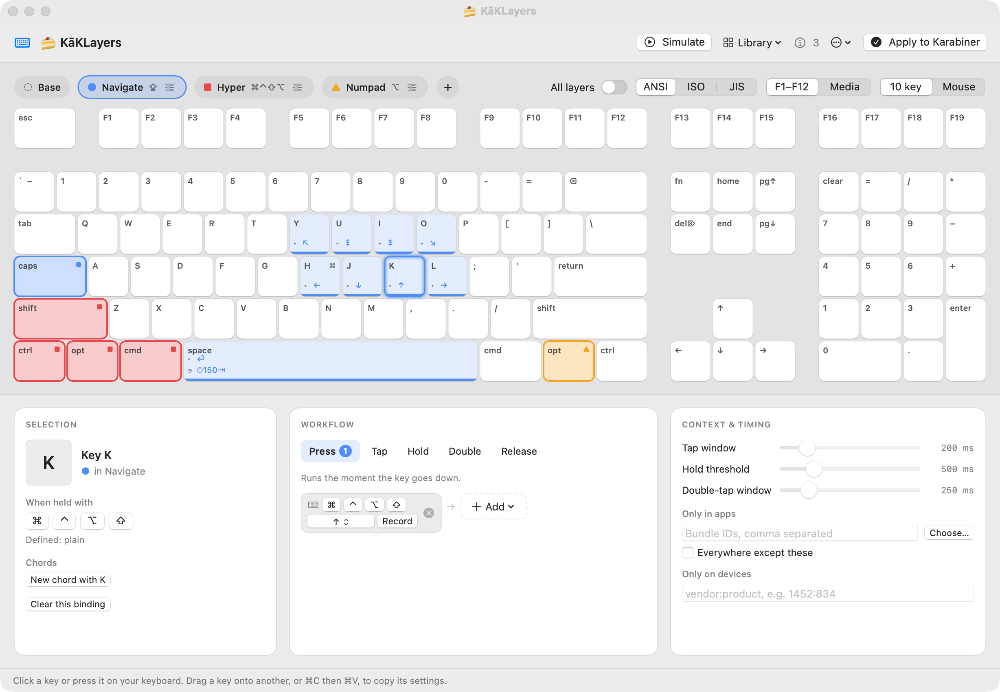
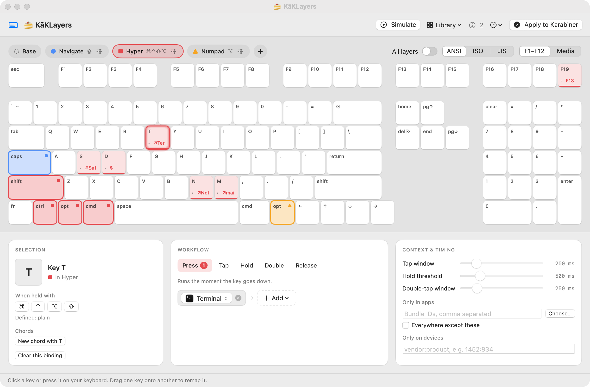
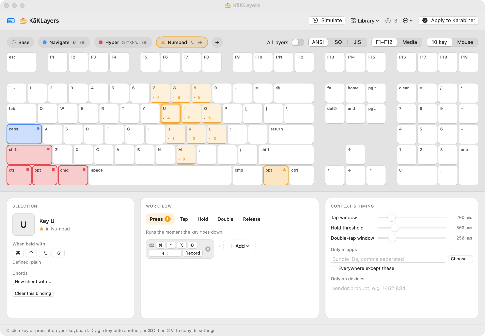
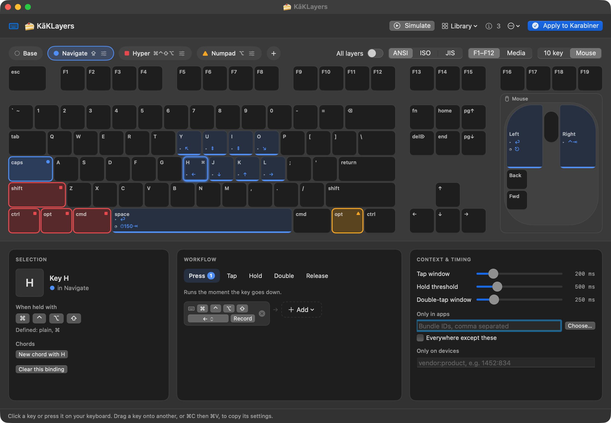
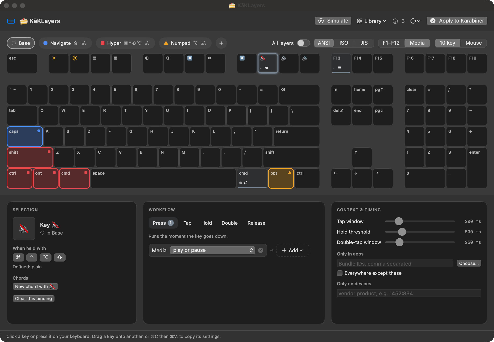
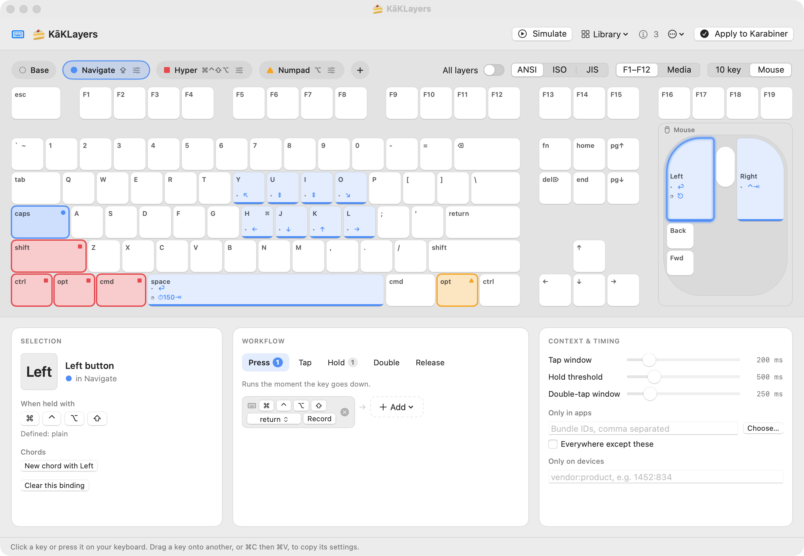
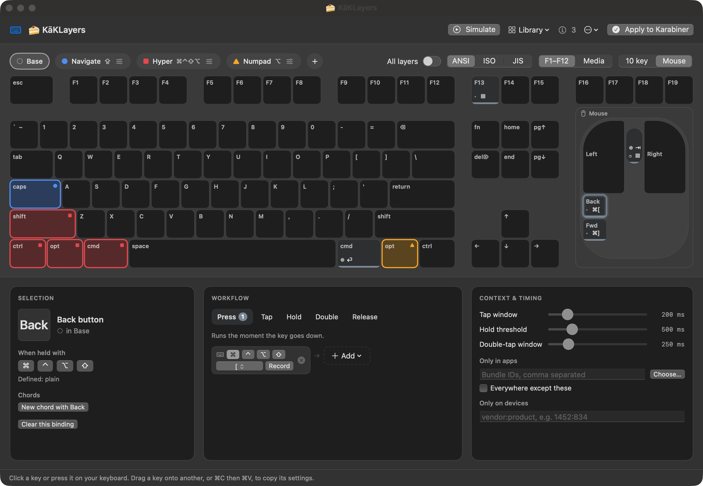

<h1 align="center">🍰 KāKLayers</h1>
<p align="center"><b>A visual GUI configurator for <a href="https://karabiner-elements.pqrs.org">Karabiner-Elements</a>: a no-scripting configuration builder for Mac.</b><br>
Build super keys, keyboard layers and advanced key workflows by clicking keys, not by writing JSON.</p>

<p align="center"></p>

**Website:** https://ekoekode.github.io/kaklayers/ · **Download:** [Releases](https://github.com/ekoekode/kaklayers/releases)

*Keywords: Karabiner configurator, Karabiner-Elements configurator, Karabiner GUI configurator, Karabiner config builder, Karabiner GUI, Mac keyboard layers, hyper key, caps lock remap, tap and hold keys, macOS key remapper.*

## Why this exists

Karabiner-Elements is wonderful, and its rule format is powerful. The configurators around it are each good at something, but none of them gave me the thing I wanted: **a quick, visual way to build layers and tap/hold keys without ever opening a JSON file.** KāKLayers is my attempt at that: native, fast, and designed so you can see your whole keyboard at once.

KāKLayers builds the configuration; **Karabiner-Elements still does the remapping**, so you need it installed. It does not replace Karabiner's own app.

**About the name:** KāKLayers = **K**arabiner **K**eyboard **Layers**.

## What you can do

- **Super keys and layers.** Tap `~` and you still get `~`; hold it and the whole keyboard becomes a layer. Triggers can be one key or a combo such as ⌘⌃⌥⇧ (a "hyper" key).
- **See everything.** The full keyboard, navigation cluster and number pad (ANSI, ISO and JIS) sit across the top. Each layer has its own colour *and* shape, so layers stay distinguishable for colour-blind users. Keys never truncate their labels.
- **Press, tap, hold, double-tap, release.** Each key has five triggers. Chain steps in any order: key presses, key down and key up (hold ⇧ while other steps run), delays, shell commands, open an app (pick from a list or browse), open a URL, media keys, mouse clicks, input-source switches.
- **Copy and paste keys.** Select a key and press ⌘C, select another and press ⌘V to copy its whole setup (workflow, modifier variants, timings, apps, devices). Or drag one key onto another; the key under the cursor lights up so you can see where it will land.
- **Mouse buttons.** Switch the 10 key to a mouse (the **10 key / Mouse** switch) and bind its Left, Right, Middle, Back and Forward buttons, record them, or use the extra buttons as layer triggers. Whether a device reports its clicks to Karabiner is up to the device (trackpads and Magic Mouse often do not), so check with Karabiner's EventViewer.
- **Modifier variants and chords.** Give ⌘H its own meaning on a layer, or bind two keys pressed together.
- **Record, don't type.** Press the combo you want and the app records it.
- **Per-app and per-device rules.** "Only in Safari", "everywhere except Terminal", or only on one keyboard.
- **Simulate before you apply.** Hold virtual layers and modifiers to see which action a key would run.
- **Safe by design.** Your `karabiner.json` is backed up before every change, and only the rules this app created are ever replaced. Everything else you have stays put.
- **The whole Mac keyboard.** F13–F19, plus a switch that redraws the top row as the media keys (brightness, Mission Control, Launchpad, backlight, playback, volume) it sends without `fn`.
- **Your files, your places.** Export the rules as a standalone Karabiner JSON, apply to any `karabiner.json` (a dotfiles repo, a second profile file), or point "Apply" at a custom location. Save and open named project files so you can keep one layout per keyboard.
- **Conflict checks.** It warns about duplicate triggers, shadowed bindings and actions that output nothing.

| Hyper layer · light | Numpad layer · light |
|---|---|
|  |  |

| Navigate layer · dark | Media row · dark |
|---|---|
|  |  |

| Mouse view · light | Mouse view · dark |
|---|---|
|  |  |

## Install

Requires **macOS 13 or later** and [Karabiner-Elements](https://karabiner-elements.pqrs.org).

**From a release:** download `KaKLayers.zip` from the Releases page and move the app to Applications. It is ad-hoc signed and not notarized, so on first launch right-click the app and choose **Open**, or run:

```bash
xattr -dr com.apple.quarantine /Applications/KaKLayers.app
```

**From source** (Xcode is not needed, only the Command Line Tools):

```bash
git clone https://github.com/ekoekode/kaklayers.git
cd kaklayers
./scripts/package.sh        # builds dist/KaKLayers.app
swift run KaKLayersSelfTest # optional: run the self-checks
```

## How it works

You edit a project; **Apply to Karabiner** compiles it to Karabiner "complex modifications" and merges the rules into the selected profile of `~/.config/karabiner/karabiner.json`. Rules are named with the prefix `[KaKLayers] `, which is how the app knows which ones it owns. A copy is also exported to `assets/complex_modifications/kaklayers.json`. Karabiner reloads the file live.

Layers are Karabiner variables (`layer_<id>`). Rule order matters in Karabiner (first match wins), so the compiler puts chords before single keys, modifier variants before plain keys, and layers in the order shown in the layer bar.

## Status

This is an early release. The compiler and layout logic are covered by self-checks (`swift run KaKLayersSelfTest`), and every Karabiner key name was checked against Karabiner's own key list. Timing-sensitive behaviour (double-tap, delays, chords, hyper triggers) depends on your keyboard and Karabiner version, so try your own rules and please [open an issue](../../issues) if something misbehaves. The Mac keyboard layouts are modelled on Apple's keyboards; the media row follows the classic Magic Keyboard.

## Privacy

Everything stays on your Mac. The app does not use the network. A small local performance log is written to `~/Library/Logs/KaKLayers/`.

## License

[MIT](LICENSE)
